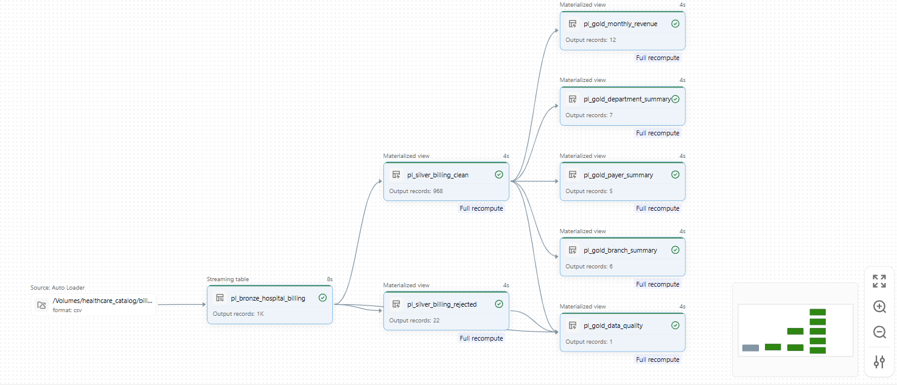
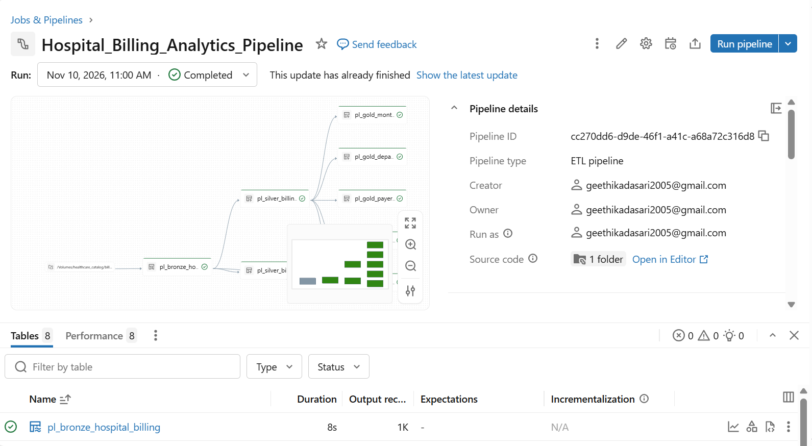
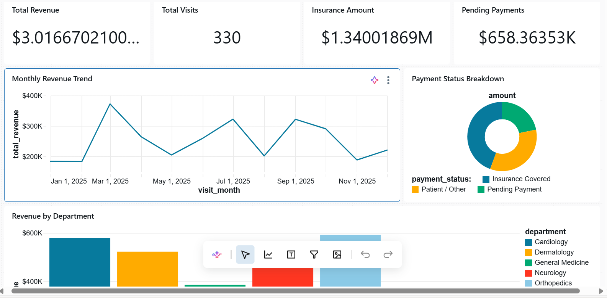
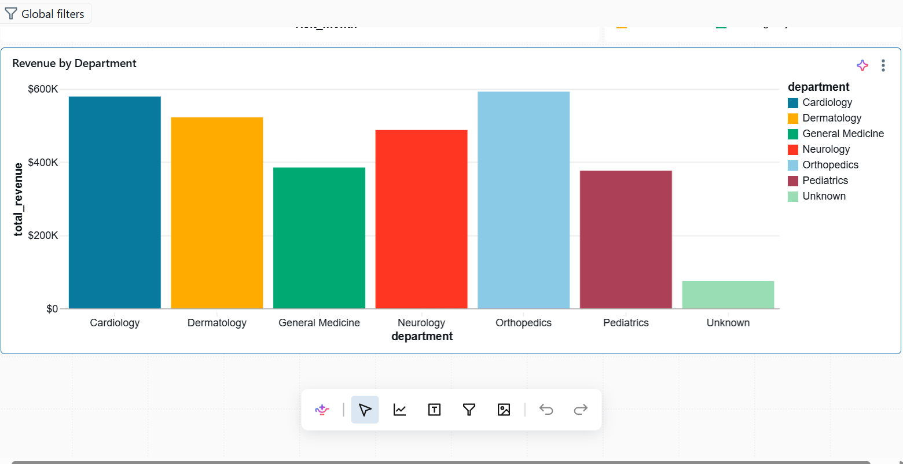
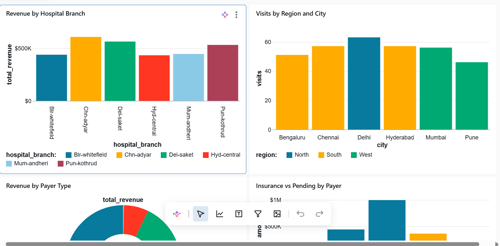
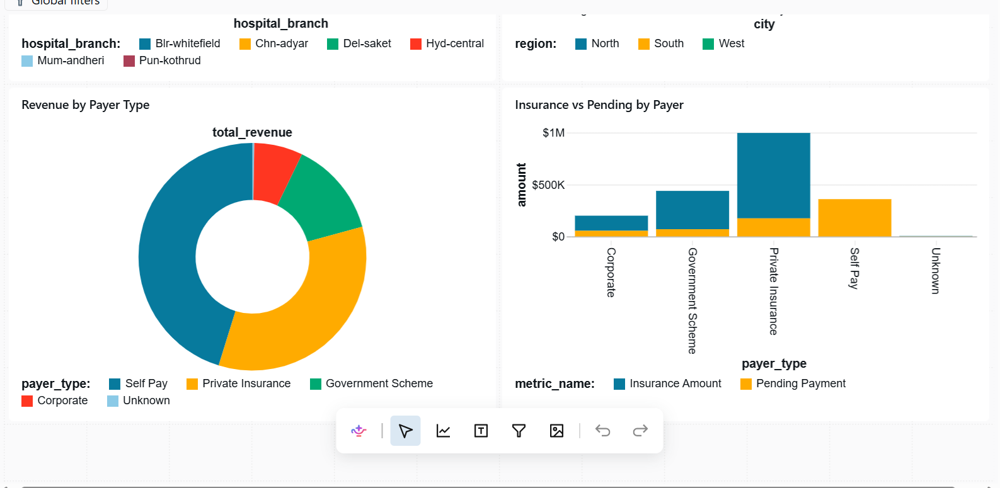
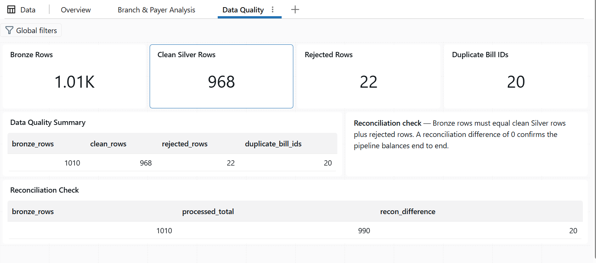
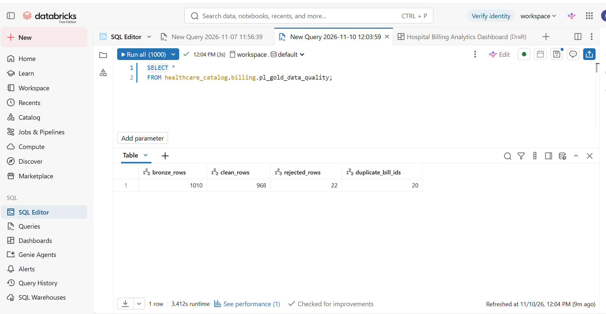

# Hospital Billing Analytics Platform

## Project Overview
The Hospital Billing Analytics Platform is an end-to-end Data Engineering project built using Databricks. It processes synthetic hospital billing data through Bronze, Silver, and Gold layers to prepare clean, structured data for analysis and reporting.

## Objectives
- Ingest hospital billing data from a CSV file.
- Clean and transform raw data.
- Identify and separate invalid records.
- Create business-level summary tables.
- Build a Lakeflow SQL pipeline.
- Present billing insights through a Databricks AI/BI dashboard.

## Technologies Used
- **Databricks** – Data processing and development
- **SQL** – Data transformation and aggregation
- **Unity Catalog** – Data organization and governance
- **Lakeflow Spark Declarative Pipelines** – Pipeline development
- **Databricks AI/BI Dashboards** – Data visualization

## Project Architecture

**CSV Data → Bronze Layer → Silver Layer → Gold Layer → AI/BI Dashboard**

### 1. Bronze Layer
- Ingested raw hospital billing data.
- Preserved source information.
- Added source file and load timestamp details.

### 2. Silver Layer
- Cleaned and standardized text columns.
- Handled missing values.
- Removed duplicate billing records.
- Separated invalid records into a rejected dataset.

### 3. Gold Layer
Created business-level summary tables:
- Monthly Revenue
- Department Summary
- Branch Summary
- Payer Summary
- Data Quality Summary

## Data Quality Results

| Metric | Records |
|---|---:|
| Bronze records | 1,010 |
| Clean records | 968 |
| Rejected records | 22 |
| Duplicate bill ID records | 20 |

**Reconciliation:** 968 clean + 22 rejected + 20 duplicate records = 1,010 Bronze records.

## Pipeline
Created a Lakeflow Spark Declarative Pipeline using SQL to manage the Bronze, Silver, and Gold transformations. Successfully executed the pipeline and verified all eight pipeline-managed tables.

## Dashboard
Developed a Databricks AI/BI dashboard with three pages:
- Overview
- Branch & Payer
- Data Quality

## Key Learnings
- Data ingestion using Unity Catalog Volumes
- Medallion Architecture (Bronze, Silver, and Gold)
- Data cleaning and transformation using SQL
- Duplicate handling and data quality checks
- Building SQL-based data pipelines
- Creating analytical dashboards in Databricks

## Conclusion
This project provided practical experience in building an end-to-end Data Engineering workflow using Databricks. It helped strengthen my understanding of data ingestion, transformation, data quality, pipeline development, and analytical reporting.

*Dataset: Synthetic hospital billing data created for learning and project purposes. No real patient information is used.*
## Project Screenshots

### Pipeline Architecture

### Successful Pipeline Execution

### Dashboard – Overview

### Dashboard – Branch & Payer

### Dashboard – Data Quality

### Data Quality Verification

